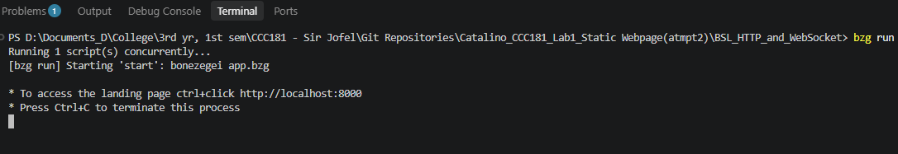
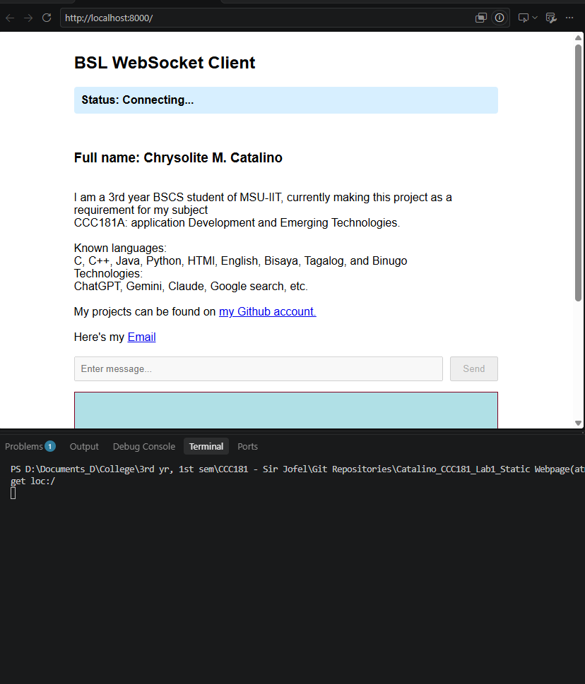
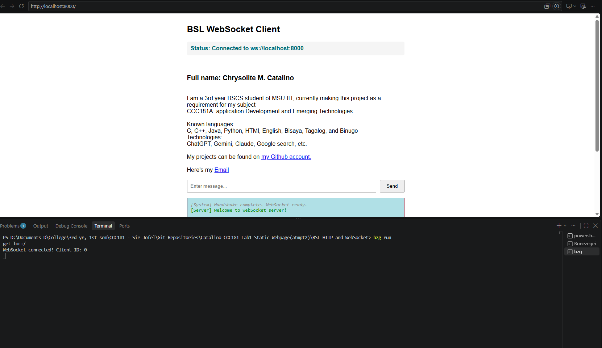

# catalino_CCC181_Laboratory1-PersonalPortfolioLandingPage

Simple HTTP and Webscket server using Bonezegei Scripting Language

``` bash
# install all dependencies
bzg install
```
Note: installing dependencies requires internet connection to access "https://www.schemastore.org/package"

``` bash
# run the app
bzg run
```
to access personal portfolio landing page, open http://localhost:8000 on your web browser.   

   

   

   
